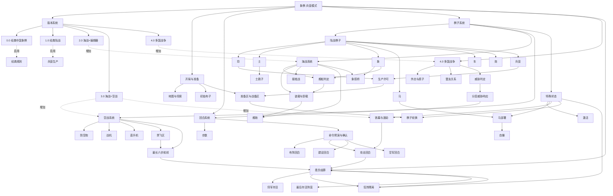
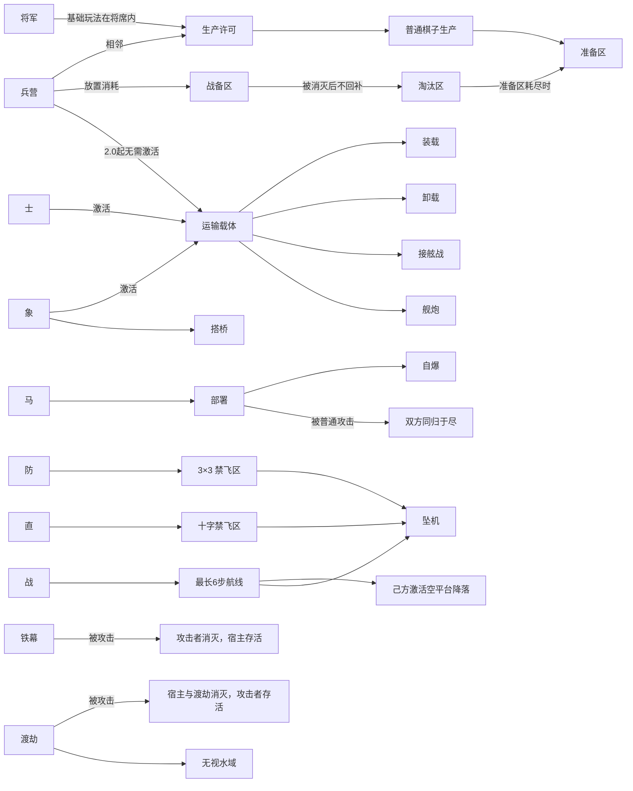
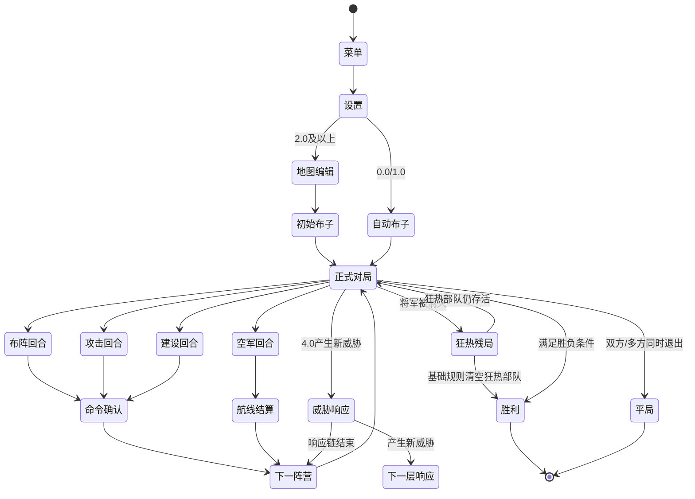

# 象棋·兵营模式关系图谱

> 本页保留 Mermaid 总览图；Obsidian 的真实节点关系图请打开 [[兵营规则图谱/00-总览]]，再执行“打开局部关系图”。详细条款请查看 [[象棋兵营模式完整规则]]。

## 一、总关系图

## 二、按游玩流程查看

1. [[象棋兵营模式完整规则#1. 游戏概览|游戏概览与版本选择]]
2. [[象棋兵营模式完整规则#3. 开局与准备阶段|开局、地图和初始布子]]
3. [[象棋兵营模式完整规则#4. 棋子、准备区与兵营|准备区、战备区与兵营]]
4. [[象棋兵营模式完整规则#5. 回合与步数|回合、步数和命令确认]]
5. [[象棋兵营模式完整规则#7. 1.0 及以上的普通棋子走法|普通棋子走法]]
6. [[象棋兵营模式完整规则#10. 海战、舰船与运输|海战与运输]]
7. [[象棋兵营模式完整规则#13. 3.0、4.0 空战规则|空战规则]]
8. [[象棋兵营模式完整规则#14. 寄生棋子|寄生效果]]
9. [[象棋兵营模式完整规则#17. 将军被消灭与狂热残局|将军死亡与狂热残局]]
10. [[象棋兵营模式完整规则#18. 4.0 多国战争|多国外交和威胁响应]]
11. [[象棋兵营模式完整规则#23. 胜负判定总表|最终胜负判定]]

## 三、版本依赖关系

| 版本 | 继承内容 | 新增核心内容 | 主要关联 |
|---|---|---|---|
| 0.0 | 标准中国象棋 | 无 | [[象棋兵营模式完整规则#8. 0.0 纯经典中国象棋走法|经典走法]] |
| 1.0 | 经典棋盘和基础棋子 | 兵营、生产、准备区、狂热残局 | [[象棋兵营模式完整规则#12. 生产规则|生产]]、[[象棋兵营模式完整规则#17. 将军被消灭与狂热残局|狂热]] |
| 2.0 | 1.0 的兵营核心 | 自定义地图、海区、舰船、搭桥 | [[象棋兵营模式完整规则#10. 海战、舰船与运输|海战]]、[[象棋兵营模式完整规则#11. 象搭桥|搭桥]] |
| 3.0 | 2.0 的海战核心 | 防空炮、战机、直升机、寄生 | [[象棋兵营模式完整规则#13. 3.0、4.0 空战规则|空战]]、[[象棋兵营模式完整规则#14. 寄生棋子|寄生]] |
| 4.0 | 3.0 的全部系统 | 2 至 8 方、外交、质子、威胁响应 | [[象棋兵营模式完整规则#18. 4.0 多国战争|多国战争]] |

## 四、棋子关系图

## 五、状态变化关系

## 六、Obsidian 内部导航

### 核心规则

- [[象棋兵营模式完整规则#5. 回合与步数|回合系统]]
- [[象棋兵营模式完整规则#6. 地形与通行|地形系统]]
- [[象棋兵营模式完整规则#12. 生产规则|生产系统]]
- [[象棋兵营模式完整规则#15. 攻击与消灭|攻击与消灭]]
- [[象棋兵营模式完整规则#16. 棋子轮换|棋子轮换]]
- [[象棋兵营模式完整规则#24. 规则优先级与判定原则|规则优先级]]

### 特殊系统

- [[象棋兵营模式完整规则#9. 激活、部署与自爆|激活、部署、自爆]]
- [[象棋兵营模式完整规则#10. 海战、舰船与运输|舰船和运输]]
- [[象棋兵营模式完整规则#11. 象搭桥|桥梁]]
- [[象棋兵营模式完整规则#13. 3.0、4.0 空战规则|空战]]
- [[象棋兵营模式完整规则#14. 寄生棋子|寄生棋子]]
- [[象棋兵营模式完整规则#18. 4.0 多国战争|外交和威胁响应]]

### 工具与实现边界

- [[象棋兵营模式完整规则#19. 地图编辑与随机地图|地图编辑]]
- [[象棋兵营模式完整规则#20. 保存、加载与撤回|存档和撤回]]
- [[象棋兵营模式完整规则#21. AI 与外部控制器|AI]]
- [[象棋兵营模式完整规则#22. 联机验证模块边界|联机验证]]
